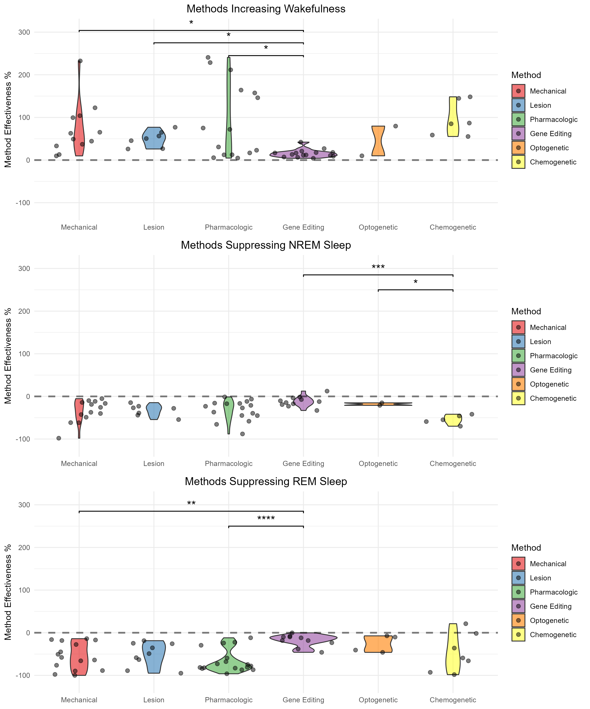

# Methods for Sleep Deprivation in Laboratory Rodent Models – Data Analysis & Visualisation

R code and dataset behind my MSc thesis in Biotechnology (NMBU, 2026), *"Methods for Sleep Deprivation in Laboratory Rodent Models: A Systematic Review"*, carried out in the Boccara Lab at the Norwegian Centre for Molecular Biosciences and Medicine (NCMBM), University of Oslo.

*Effectiveness of each method category in wakefulness, NREM and REM sleep.*

## About the project

Many experimental methods are used to deprive rats and mice of sleep, from gentle handling and lesions to pharmacology, gene editing, optogenetics and chemogenetics. Choosing between them is difficult, because studies differ in what they target, how they measure it and how well the method works.

I systematically reviewed **100 peer-reviewed articles covering 161 experiments (1946–2025)** and built a structured dataset. For each experiment it records the method and sub-method, the targeted brain region and area, the species, the age, the duration of the recording and the effect on wakefulness, NREM and REM sleep. The analysis compares how effective and how precise each method category is, and the results were used to build a decision framework for choosing a method.

**Method effectiveness** is the percentage change in wake or state-specific sleep duration during the manipulation, measured against an equal-length baseline window before it. Positive values mean the state increased, negative that it decreased.

| Method category | Experiments |
|---|---|
| Gene editing | 35 |
| Pharmacologic | 32 |
| Mechanical | 27 |
| Optogenetic | 24 |
| Chemogenetic | 22 |
| Lesion | 21 |

The dataset covers 114 experiments in mice and 47 in rats.

## Analysis

**Descriptive analysis**
- How the use of each method category has developed over time (area and line charts, 2010–2025)
- How the methods break down into sub-methods, and how they are distributed across species and the sleep stage they target
- Heatmaps of method effectiveness by targeted brain region (cortex, hypothalamus, thalamus, basal forebrain, basal ganglia, midbrain, pons, medulla)

**Statistical analysis** (run separately for wakefulness, NREM and REM)
- Mean, SD and SEM for each method category
- **Welch's ANOVA**, which does not assume equal variances, followed by the **Games–Howell** post hoc test
- **Estimation statistics** with `dabestr`: mean differences against a shared control, with 5000 bootstrap resamples for confidence intervals. In each state the control is the method with the highest mean effectiveness.
- Violin plots overlaid with the individual data points and significance brackets
- The relationship between effectiveness and the duration of the recording

Before the statistical analysis, extreme outlying values were removed, and experiments that did not target the state under analysis were excluded from that state's comparison.

## Repository contents

| File | Description |
|---|---|
| `R Code Thesis.R` | Full analysis pipeline: data preparation, figures and statistics. Sections follow the results chapters of the thesis (4.1–4.8). |
| `R Studio Dataset (Sleep Deprivation).xlsx` | Curated dataset: 161 experiments, 14 variables |

Data were extracted from the original articles into Excel, with references managed in EndNote, and every entry was cross-checked against its source article before analysis.

The dataset here is the exact version used for the analysis in the thesis. A continuously updated version of the literature table is maintained by the lab at [boccaralab.com/datasets/sleep_dep](https://boccaralab.com/datasets/sleep_dep/).

## Tools

**R 4.5.0** / RStudio

- Data handling: `dplyr`, `tidyr`, `reshape2`
- Visualisation: `ggplot2`, `plotly`, `lattice`, `gridExtra`, `grid`, `ggtext`, `ggsignif`, `RColorBrewer`, `viridis`
- Statistics: `rstatix`, `dabestr`
- `nmbu`: an NMBU course package

## How to run

1. Install the packages listed at the top of `R Code Thesis.R`.
2. Run the script from the repository folder, section by section. Each section produces the figures and tables for the matching part of the thesis.

## Limitations

Worth knowing before reusing these numbers:

- Sample sizes are small in several method–state combinations, because few recent papers report raw data rather than illustrative values. This affects optogenetics and chemogenetics most.
- Recordings of 24 hours are over-represented where both 12- and 24-hour data were available.
- Confounders such as stress, handling and procedural effects are not adjusted for.
- Coverage of the most recent publication years is incomplete, so apparent declines there are not real trends.

## Acknowledgements

Thesis work was supervised by Dr. Charlotte Boccara (Boccara Lab, NCMBM, University of Oslo) and Prof. Gaute Tomas Einevoll (NMBU). I am grateful to Alessandro Arena for his guidance on the statistical analysis and visualisation.

## Citation

> Myrland, H. N. (2026). *Methods for Sleep Deprivation in Laboratory Rodent Models: A Systematic Review* [Master's thesis]. Norwegian University of Life Sciences (NMBU).

## Author

**Henriette N. Myrland** – MSc in Biotechnology (NMBU), one-year programme in Informatics (UiO)
[LinkedIn](https://www.linkedin.com/in/henriette-nikolaisen-myrland-95541821b/)
